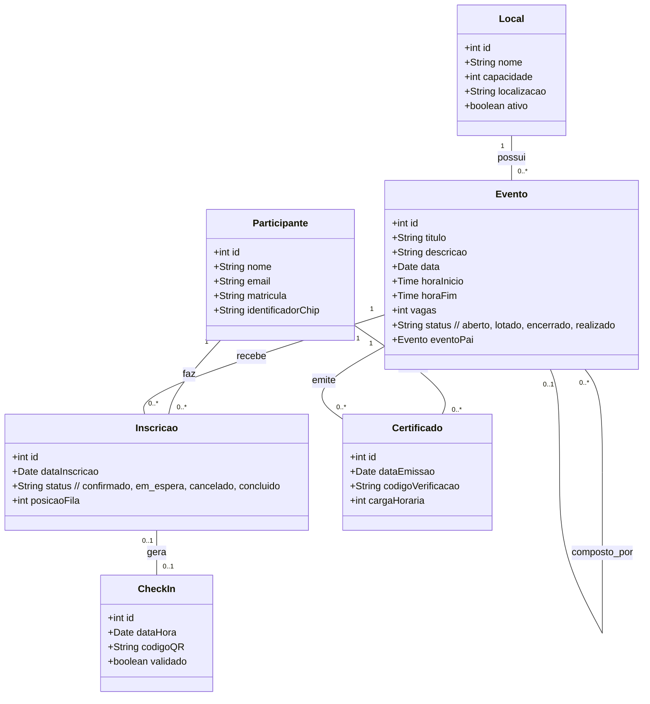

# Modelo de Domínio – G15

## Diagrama de Classes Conceitual

---

## Descrição das Classes

| Classe        | Descrição                                                                 | Atributos principais                                                                                                  |
|---------------|---------------------------------------------------------------------------|-----------------------------------------------------------------------------------------------------------------------|
| **Local**     | Auditório ou espaço físico onde os eventos acontecem.                     | `id`, `nome`, `capacidade` (número máximo de pessoas), `localizacao`, `ativo` (para desativar locais)                 |
| **Evento**    | Atividade acadêmica (palestra, seminário, etc.) com data, horário e local. | `id`, `titulo`, `descricao`, `data`, `horaInicio`, `horaFim`, `vagas` (limite de participantes), `status` (aberto, lotado, encerrado, realizado). Relacionamento recursivo para subeventos. |
| **Participante** | Usuário que se inscreve e participa de eventos.                           | `id`, `nome`, `email`, `matricula`, `identificadorChip` (para leitura de crachá, opcional).                          |
| **Inscricao** | Vínculo entre um participante e um evento, com situação.                  | `id`, `dataInscricao`, `status` (confirmado, em_espera, cancelado, concluido), `posicaoFila` (para controle de ordem). |
| **CheckIn**   | Registro de presença efetiva no evento.                                   | `id`, `dataHora`, `codigoQR` (identificador gerado para cada inscrição confirmada), `validado` (indica se já foi usado). |
| **Certificado** | Documento emitido para participante com presença registrada.              | `id`, `dataEmissao`, `codigoVerificacao` (único para conferência), `cargaHoraria` (calculada a partir do evento).    |

---

## Relacionamentos e Multiplicidades

- **Local (1) – Evento (0..*)**  
  Um local pode abrigar vários eventos, mas cada evento ocorre em um único local. A regra de negócio RN01 (não pode haver horários sobrepostos) é uma restrição de integridade que deve ser verificada antes de associar um evento a um local.

- **Evento (0..*) – Evento (0..1) (auto-relacionamento)**  
  Um evento pode conter vários subeventos (ex: palestras dentro de uma semana acadêmica). Cada subevento tem no máximo um evento pai. Isso permite composição hierárquica sem criar uma classe separada.

- **Participante (1) – Inscricao (0..*)**  
  Um participante pode se inscrever em vários eventos, e cada inscrição pertence a um único participante. A RN06 (sem inscrição duplicada) é garantida por uma chave única composta (Participante + Evento).

- **Evento (1) – Inscricao (0..*)**  
  Um evento pode receber muitas inscrições, e cada inscrição refere-se a um único evento. O controle de vagas (RN03) é feito sobre o total de inscrições com status “confirmado”.

- **Inscricao (0..1) – CheckIn (0..1)**  
  Uma inscrição confirmada pode gerar no máximo um check-in, e um check-in está associado a uma única inscrição. A RN08 (reutilização) é aplicada aqui – uma vez registrado, o check-in não pode ser usado novamente.

- **Participante (1) – Certificado (0..*)**  
  Um participante pode obter vários certificados (um por evento com presença), e cada certificado pertence a um único participante.

- **Evento (1) – Certificado (0..*)**  
  Um evento pode emitir vários certificados (um para cada participante presente), e cada certificado refere-se a um único evento.

---

## Regras de Negócio Refletidas no Modelo

| Regra | Como o modelo atende |
|-------|----------------------|
| RN01 (conflito de horários) | Restrição sobre a associação Local-Evento; deve ser validada antes de persistir. |
| RN03 (vagas não excedidas) | Controle no momento da criação da Inscricao: número de confirmados < vagas do Evento. |
| RN04 (fila de espera) | Status `em_espera` na classe Inscricao, com atributo `posicaoFila`. |
| RN05 (ordem de promoção) | Promoção baseada na `posicaoFila` ou data de inscrição – o sistema garante a ordem. |
| RN06 (sem inscrição duplicada) | Chave única composta por Participante + Evento na classe Inscricao. |
| RN07 (check-in só para confirmados) | Validação no momento do CheckIn: apenas inscrições com status “confirmado” são aceitas. |
| RN08 (check-in único) | Atributo `validado` e cardinalidade 0..1 entre Inscricao e CheckIn. |
| RN09 (certificado só com presença) | Geração condicionada à existência de um CheckIn associado à Inscricao. |
| RN10 (código único) | Atributo `codigoVerificacao` em Certificado, com restrição de unicidade. |

---
